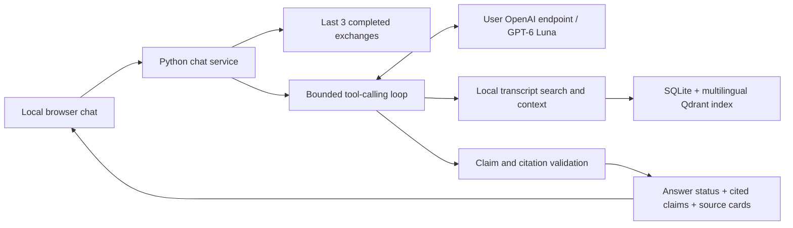

# ExecPlan: local chat UI, bounded memory and agentic RAG

Status: implementation delivered, automated/live checks recorded below. The human
benchmark review gate remains open; do not interpret implementation as quality sign-off.
Source of truth: [chat specification](../docs/CHAT_UI_SPEC.md), existing product,
architecture, data model, retrieval and evaluation docs. Date: 2026-10-24.

## Goal

Ask questions about the local YouTube knowledge base in a simple browser chat.
Use the user's OpenAI endpoint and a lightweight GPT-6 model, remember three recent
exchanges, let a bounded agent retrieve evidence, and explicitly highlight missing
citations. Deliver a local application against the already ingested playlist.

## Starting implementation and gaps (before this milestone)

- `retrieval.search` already supplies hybrid candidates, chunk/segment IDs, parent
  context and timestamp URLs. The local database contains 20 videos and 1,422 chunks.
- `SemanticIndex` and FastEmbed work with the Russian playlist; keep those assets.
- `answering.answer` is an evidence reporter plus an optional Ollama adapter.
  Its validator checks citation membership, not factual entailment.
- There is no web server, UI, session memory or OpenAI provider integration.
- Broad parent expansion produced weakly related live results. Source presence
  therefore cannot be the sole test for whether a generated answer is supported.
- Store connections are SQLite thread-bound; Qdrant local has an exclusive process
  lock. Do not open a fresh vector client or reload the embedding model per request.

## Chosen architecture

Use one Python service with **FastAPI + Uvicorn**, serving plain HTML/CSS/JavaScript
and its own JSON API. Reuse Python domain/retrieval code directly. No React build,
LangChain, hosted vector service or agents framework is required. These are design
choices, not claims about current framework versions; resolve and pin versions at
implementation time. Add a `chat` optional dependency group with the OpenAI SDK.



The backend owns credentials, history, evidence registration and status decisions.
It reads the existing corpus; chat history stays in process memory and requires no
source database migration. Use the default live dataset paths but allow overrides.
Provider calls use an interface separate from Ollama and from embedding providers.
Keep the current CLI and optional local synthesis behavior backward compatible.

## Configuration and endpoint compatibility

Implemented environment settings (template values; credentials are local):

```dotenv
OPENAI_API_KEY=<configured locally; never committed>
OPENAI_BASE_URL=https://api.openai.com/v1
OPENAI_MODEL=gpt-6-luna
OPENAI_REASONING_EFFORT=low
KB_DB=data/live/kb.sqlite3
KB_INDEX_DIR=data/live/semantic
KB_EMBEDDING_MODEL=sentence-transformers/paraphrase-multilingual-MiniLM-L12-v2
FASTEMBED_CACHE_PATH=data/models/fastembed
CHAT_MEMORY_TURNS=3
CHAT_HOST=127.0.0.1
CHAT_PORT=8000
```

Recommend `gpt-6-luna` for the initial cost-sensitive trial, based on the
[official model page](https://developers.openai.com/api/docs/models/gpt-6-luna)
and [catalog](https://developers.openai.com/api/docs/models). Quality must be
measured on this corpus. Do not assume hypothetical `gpt-6-mini`/`nano` aliases.
Keep the model editable and show its configured name in a small settings/status
area. Never automatically switch to a more expensive model.

Before the live provider smoke test, establish whether the endpoint is standard
OpenAI, an OpenAI-compatible gateway or Azure with a deployment-specific contract.
Check Responses, tool calling, strict structured output and reasoning settings
on that endpoint. Unsupported capabilities produce a clear configuration error;
do not silently switch APIs or weaken citation enforcement. An explicit later
adapter can support other contracts. No credential is needed to review this plan.

## Implemented contracts and modules

| Module | Responsibility |
| --- | --- |
| `chat/config.py` | Validated environment settings, provider/model limits, dataset paths. |
| `chat/contracts.py` | ChatRequest, Turn, AnswerClaim, Citation, AnswerEnvelope, tool schemas. |
| `chat/memory.py` | Session-scoped rolling pairs, reset, TTL and per-session request lock. |
| `chat/providers/openai.py` | SDK Responses adapter, structured output, capability/error handling. |
| `chat/tools.py` | Read-only search/context tools and request-local evidence registry. |
| `chat/agent.py` | Bounded retrieval/refinement/synthesis loop with deadlines. |
| `chat/validation.py` | ID/quote/time checks, support assessment and deterministic notices. |
| `chat/service.py` | Memory, retrieval and provider orchestration independent of HTTP. |
| `web/app.py` | API endpoints, lifecycle, static files and resource ownership. |
| `web/static/` | Chat page, styles and small JavaScript client. |
| `scripts/start-chat.ps1` | Validated local startup with one server worker. |

`ChatRequest`: message, client request ID; session identity is issued by the server.
`AnswerEnvelope`: reply ID, status, claims, citations, unanswered parts, notice,
optional error code, model name and available token/latency/tool-call statistics.
`AnswerClaim`: text and nonempty citation IDs. No freeform factual answer field may
bypass these claims. `Citation`: server-resolved source ID, video/chapter title,
chunk/segment IDs, original excerpt, source times, language and caption origin.
The model returns source handles, not arbitrary URLs; the server builds links.
The server derives which sources were actually used and drops unused source cards.

## Memory rules

1. For question N, include at most the three most recent completed pairs before N,
   then the current message. This means six historical messages, not three pairs
   plus an unbounded provider conversation.
2. Send an explicit history window on every new turn with `store=False`; do not
   chain `previous_response_id` across user turns or create a hosted conversation.
   Within one agent turn, retain the required ordered tool-call/result items.
3. Retain user text and the rendered validated assistant response, including its
   evidence status and compact source references. Do not retain hidden reasoning
   or tool dumps as long-term memory. Old source handles guide follow-up search;
   they must be freshly resolved before being used as evidence.
4. Use in-memory server sessions, expiring after configurable inactivity (default
   one hour). Reset invalidates the session's memory and the page transcript.
5. Only completed responses add a pair. Failed/cancelled requests do not; duplicate
   request IDs return the completed result rather than appending a second pair.
6. Bound memory by tokens as well as pair count. Drop the oldest whole pair if it
   does not fit; report the effective retained count. Never split a pair silently.

## Bounded agent policy

Tools are strict typed read-only functions:

- `search_transcripts(query, video_ids_or_null, k)`: lexical+dense search. Filters
  refer only to known local videos; clamp k server-side. Register source passages
  under request-local handles. Prior cited video metadata can focus a follow-up.
- `get_context(source_handle, neighbor_count)`: resolve only registered handles,
  return at most one neighbor each side, in the same video/chapter. Each expanded
  passage gets its own handle and source provenance before it can be cited.

Force initial search for a factual question. The model can reformulate the search
from the current question and bounded history, then choose at most one additional
search and one bounded context expansion. No unsupported answer may skip retrieval.
Use original excerpts as evidence; parent representations are retrieval hints.

Initial limits, all configurable downward or after measured tuning:

| Limit | Initial value |
| --- | --- |
| Provider requests per user turn, including retries/repair | 4 |
| Search calls / context expansion calls | 2 / 1 |
| Total tool executions | 3 |
| Unique evidence passages sent per turn | 12 |
| Evidence budget / total model input budget | 8,000 / 12,000 tokens |
| Output budget per provider request | 1,800 tokens |
| End-to-end deadline | 60 seconds |

Count and validate every tool call even if the provider returns multiple calls.
Disable parallel tool calling initially. SDK automatic retries must not exceed
the application request budget. On budget exhaustion, provide a validated partial
answer only if it is available; otherwise return no-support/verification-failed
with an explicit reason. Timeouts and index failures remain errors, not abstentions.
Do not guess precise token counts when the gateway omits usage; mark them unknown.

## Citation and answer policy

Retrieve → assess support → produce typed claims → validate → render. Source
existence and an ID allow-list are necessary but insufficient. The final structured
answer must identify the supporting excerpt for each claim; code checks that the
excerpt is an exact substring of the original source and that bounds/IDs belong
to the current evidence registry. Keep source statements attributed to the video.

Use model-assisted support assessment on original passages; it is not a guarantee
of entailment. A second checking/repair call is permitted only within the same
four-request budget. If checks reject a claim, remove/repair it or withhold the
answer, then recompute grounded/partial/no-support status from validated content.
An empty or irrelevant candidate set must never become a confident factual answer.

The UI and server use the exact notices in CHAT_UI_SPEC.md. Distinguish:
no candidates; candidates but no support; some supported subquestions; invalid
citations; and infrastructure errors. No general-knowledge fallback in this release.
History and transcripts are untrusted data and cannot authorize tool use, change
the system policy or make unsupported source references valid.

Render only final validated content. Initially use a normal HTTP response and a
loading indicator; postpone raw token streaming so uncited draft claims never
appear as completed answers. Preserve fixed notices in copy-to-clipboard output.

## Server lifecycle and UI

Endpoints: `GET /` (chat), `GET /api/status` (sanitized readiness/model/corpus
summary), `POST /api/chat`, `POST /api/chat/reset`. No credentials in browser storage
or responses; load server secrets from environment or an ignored local `.env`.
Render transcript/user content as text or escaped safe formatting, never raw HTML.

One server process owns one embedding model and one Qdrant client for its lifetime;
release both on shutdown. Create SQLite connections in the worker thread performing
the query. Serialize local inference/index access and use per-session locks for
ordered messages. Do not use multiple Uvicorn workers or live reloading against
the same local index. Indexing is an offline maintenance operation: stop chat,
reindex, restart. Stale/missing indexes give an explicit readiness error.

## Implementation phases and acceptance gates

### 1. Provider configuration and contracts
Scope: optional dependencies, configuration, OpenAI adapter and typed envelopes.
Tests: custom base URL/model are honored; key never returned/logged; tool/JSON
schema handling; missing configuration, 401/403/429, timeout, incomplete/refusal
and incompatible endpoint responses. Use mocked HTTP by default.
Gate: a documented explicit opt-in endpoint smoke test succeeds with the configured
model. No automatic paid calls on import or ordinary unit tests. Dependencies: none.

### 2. Session memory and application service
Scope: session isolation, three-pair window, reset, ordering and idempotent requests.
Tests: fourth-oldest pair excluded from the fifth request; current question appears
once; failed requests excluded; no-support pairs retained; reset and TTL clear
history; two sessions cannot see each other; token trimming drops complete pairs.
Gate: captured provider inputs prove the memory bound and fresh retrieval policy.
Dependencies: phase 1 contracts.

### 3. Retrieval tools, relevance and agent limits
Scope: wrap existing retrieval; evidence registry; fresh contextual follow-up search;
bounded query retry and context expansion. Address parent expansion with a bounded
child selection and measure against the current baseline before choosing weights.
Tests: narrow detail still enters through chunk search; unrelated parent children
are not all promoted equally; invalid/stale handles rejected; expansion bounded;
injected source instructions cannot change tools; all loop/deadline limits enforced.
Gate: a deterministic agent fixture exercises search → refinement → stop and
follow-up resolution without reading beyond the last three exchanges.
Dependencies: phases 1–2 and the existing semantic index.

### 4. Citation validation and explicit missing-support behavior
Scope: exact source checks, structured claims, support assessment, status derivation,
fixed notices and bounded repair. Keep errors distinct from lack of evidence.
Tests: zero candidates; irrelevant candidates; model says grounded without claims;
invented IDs/URLs; real ID with unrelated quote; altered excerpt; invalid time span;
partially supported multipart question; API/index failure; exhausted budget.
Gate: no unsupported factual draft is rendered; every factual claim has a validated
source reference; absent evidence always produces the conspicuous notice.
Dependencies: phases 1–3. Automated checks must not be labeled proof of entailment.

### 5. Local browser chat
Scope: server/static UI, composer, pending state, ordered bubbles, reset and source
cards with timestamps. Start via a single documented command on loopback.
Tests: API contract; no source/key leakage; safe rendering; empty/oversized input;
pending/failed requests; session lifecycle; keyboard send; citation navigation;
no-support and partial notices remain visible and survive copying the answer.
Gate: browser smoke test completes a cited answer, a contextual follow-up and an
unsupported question; loading an API error never displays a fabricated answer.
Dependencies: phases 1–4.

### 6. Live playlist evaluation and release documentation
Create a local human-reviewed set of at least 20 questions: 8 direct, 4 paraphrased,
3 contextual follow-ups, 3 unanswerable and 2 partially answerable multipart cases.
Assign gold source intervals and expected support states; inspect the actual
transcripts rather than generating labels solely from retrieval results. Keep
questions/gold references separate from copyrighted transcript artifacts.

Measure Recall@5/MRR, claim citation validity, human-rated entailment, no-support
accuracy, memory isolation, latency and provider usage. Compare one-pass retrieval
with the bounded agent. Require all deterministic safety/state tests to pass, zero
fabricated citations, and correct no-support labels on all reviewed unanswerable
cases. Human-review every factual claim in this initial small set; record misses
and improve/retest affected cases before declaring the milestone complete.

Run existing pytest/ruff checks and new API/UI tests; run an opt-in real endpoint
check in `.venv-live`. Record the actual model, endpoint type (no credentials),
dataset snapshot and request/token counts; do not invent a latency/cost SLA before
measurement. Provide `.env.example`, optional-dependency installation, start-chat
script, query examples and limitations. No public deployment in this phase.
Dependencies: phases 1–5 and configured endpoint credentials.

## Verification commands

Keep existing `python -m pytest`, `python -m ruff check .`, and
`python -m ruff format --check .`. Add focused chat/API/agent tests and a browser
smoke test. The implemented startup entry point is
`yt-kb chat --host 127.0.0.1 --port 8000`; see [CHAT.md](../docs/CHAT.md).

## Resolved live provider configuration

- Standard OpenAI, `https://api.openai.com/v1`, model `gpt-6-luna`, reasoning low.
- User key in ignored root `.env`; Responses/tools/structured output tested live.

Never ask the user to paste API keys into chat.

## Progress

- [x] Inspect current code and live-playlist results; check official OpenAI docs.
- [x] Specify UI, memory, provider, agent bounds and absent-citation behavior.
- [x] Phase 1: provider adapter and configuration; real account/model access verified.
- [x] Phase 2: session memory, isolation, TTL, reset and request deduplication.
- [x] Phase 3: retrieval tools, video filters, bounded agent and comparison harness.
- [x] Phase 4: claim/citation enforcement, bounded correction and fixed notices.
- [x] Phase 5: browser UI/API; real cited answer and fixture state checks.
- [x] Phase 6 implementation: 20-case benchmark, paid comparison and release docs.
- [ ] Phase 6 quality sign-off: human review of gold relevance and every factual claim.

## Implementation verification, 2026-10-25

- 67 offline tests pass, including the existing CLI suite, mock OpenAI HTTP contracts,
  memory trimming/isolation/cancellation, source corruption, tool limits and errors.
- Ruff lint/format pass. Wheel contains all three static assets; `pip check` passes.
  Windows Python 3.12 resolved dependencies are pinned for `setup-live.ps1`.
- Browser fixture verifies citations, follow-up memory, no-support/partial/error
  notices, copy behavior and reset. It is explicitly labeled synthetic. The real
  server separately returned a Russian attributed answer with its exact original
  quote and a working timestamp at 369 seconds in video `hLDmyM3b0CA`.
- Live testing found an overly conservative byte-based Russian input estimate;
  application startup now loads a tokenizer with a safety margin. Displayed billed
  usage still comes from the provider. Missing usage remains unknown.
- A malformed quote can receive one correction if synthesis and separate checking
  still fit the four-request budget. Otherwise the draft remains withheld.
- Initial comparison completed all 40 requests (20 cases per mode): single-pass
  matched 17/20 expected statuses, bounded agent 15/20. Both abstained correctly on
  all three unanswerables; no returned citation failed structural provenance checks.
  This does not establish factual correctness or an agentic quality improvement.
- Original chunks/gold intervals were inspected by the assistant. That is not human
  review. Generated answers and full local reports remain under ignored `data/live/`.
  Final results and known misses are in [EVALUATION.md](../docs/EVALUATION.md).

## Official references checked 2026-10-24

- [Models and GPT-6 Luna](https://developers.openai.com/api/docs/models/gpt-6-luna):
  lightweight default; configured account access subsequently verified live.
- [Function calling](https://developers.openai.com/api/docs/guides/function-calling):
  application tools, forced retrieval and strict argument schemas.
- [Structured outputs](https://developers.openai.com/api/docs/guides/structured-outputs?api-mode=responses):
  typed final responses; handle refusals and incomplete output explicitly.
- [Conversation state](https://developers.openai.com/api/docs/guides/conversation-state):
  explicit history management for the rolling memory window.
